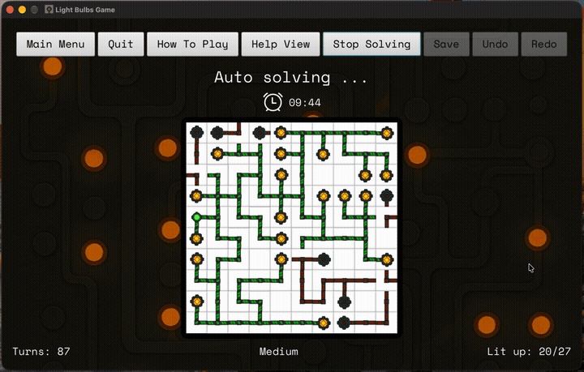
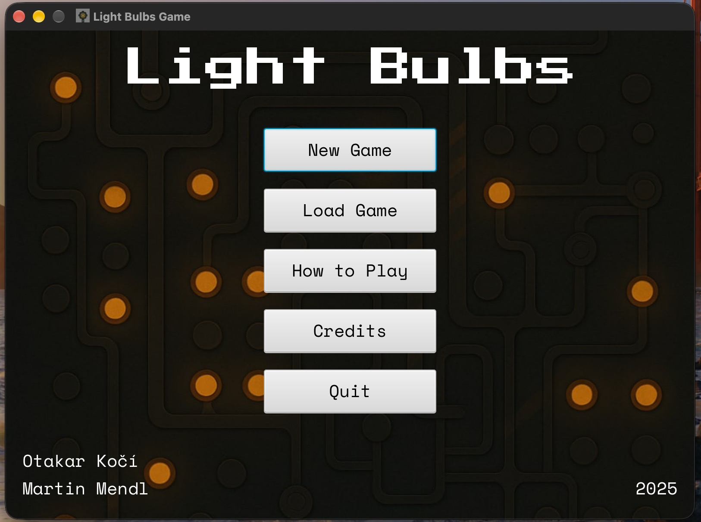
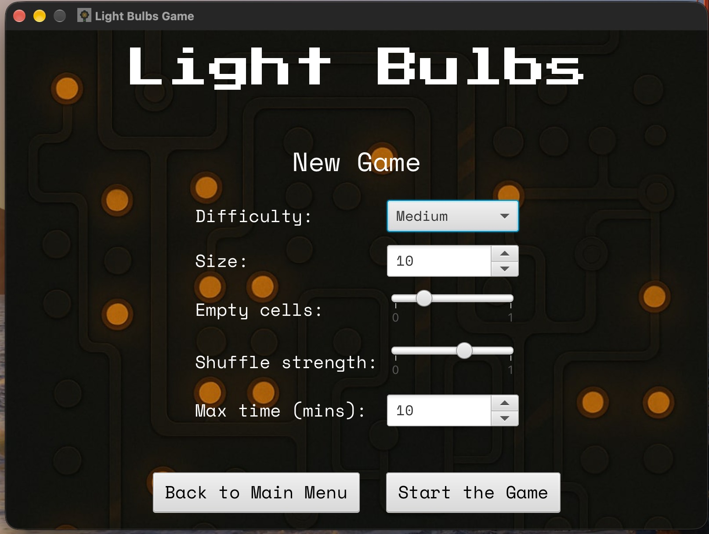
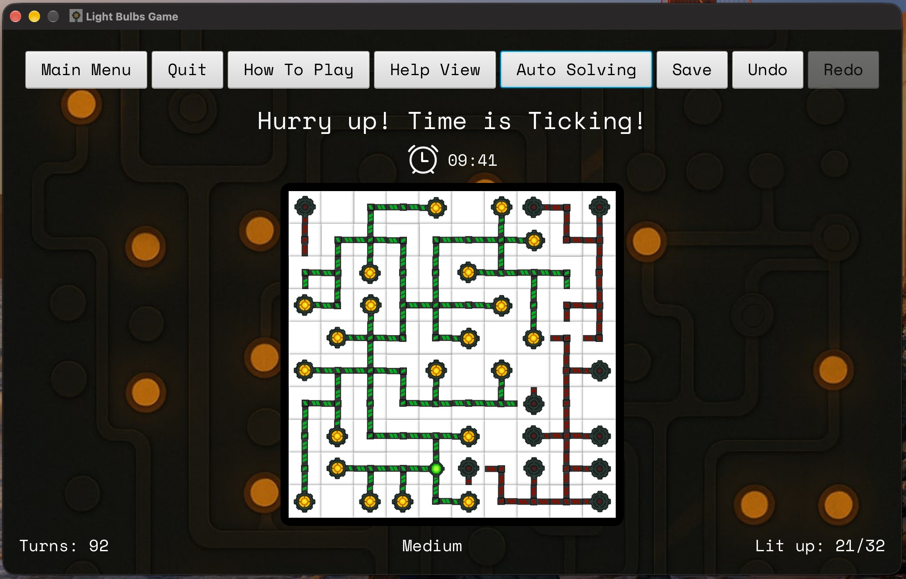

# Light Bulbs

A JavaFX puzzle game where you rotate wire, power and bulb tiles until every bulb on the board lights up.



## Features

- **Random map generation**: every new game builds a fresh board with a modified Jarník's (Prim's) algorithm, which keeps every tile connected. You can set the board size, how many cells are empty, and how strongly the board is shuffled
- **Difficulty presets** and an optional **time limit**
- **Undo / Redo** for every move
- **Save & Load**: games are stored as plain JSON (examples are in [`data/`](data))
- **Auto solving** and a **Help View** that shows the solution
- Built-in **How to Play** and **Credits** screens

## Screenshots

| Main menu | New game setup | In game |
|:---:|:---:|:---:|
|  |  |  |

## Getting Started

**Requirements:** Java 21+ and Maven.

```bash
mvn package                       # builds target/lightbulbgame.jar (all dependencies included)
java -jar target/lightbulbgame.jar
```

You can also use the Makefile:

| Command | What it does |
|---|---|
| `make try` | clean, build and run |
| `make build` | build the jar |
| `make run` | run the jar you built |
| `make docs` | generate Javadoc into `docs/` |
| `make build-all` | docs and build together |

The jar includes the JavaFX native libraries for Linux, Windows and macOS.
> Jars built on Windows have had problems running on macOS. If that happens, rebuild the jar on the machine you'll run it on.

## Project Structure

```
src/main/java/com/example/game/
├── gui/      JavaFX controllers and the app entry point (Main)
├── model/    game logic, map generator, undo backlog, timer
└── shared/   observer interfaces and shared types
src/main/resources/   fonts, icons, backgrounds
data/                 example save files
```

## Authors

**Team 247555**
- Otakar Kočí (xkocio00)
- Martin Mendl (x247581)

## License & Credits

- Fonts from Google Fonts: [Space Mono](https://fonts.google.com/specimen/Space+Mono), [Press Start 2P](https://fonts.google.com/specimen/Press+Start+2P)
- Alarm clock icon from [icons8.com](https://icons8.com/icons/set/alarm-clock--corners-round)
